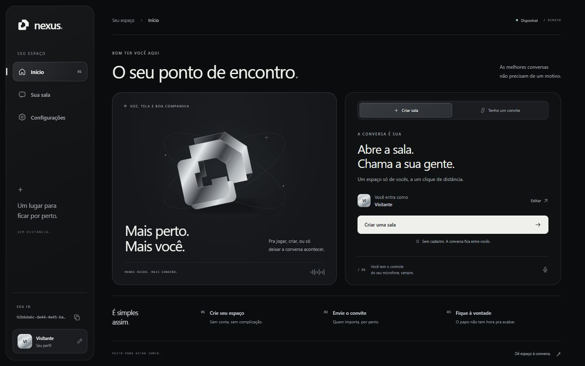

# Nexus

Um espaço para conversar por voz e compartilhar a tela, direto no navegador.

A interface usa preto, grafite e acabamentos cromados, com marca vetorial própria, navegação responsiva e transições que respeitam a preferência de movimento reduzido. **Nexus é o nome provisório desta etapa.**

## Estrutura

- `index.html`: início, sala, preferências e diálogos.
- `style.css`: sistema visual, tamanhos de tela e animações.
- `ui.js`: formulários, seleção de perfil e estados da interface.
- `avatars.js`: catálogo de perfis e monogramas.
- `script.js`: chamadas, áudio, transmissão e sinalização PeerJS.
- `assets/mark.svg`: símbolo vetorial da marca.

O projeto continua estático, sem etapa de build. Sirva a raiz em localhost ou publique em um host HTTPS. O carregamento do PeerJS utiliza a CDN já usada pelo projeto.

## Perfis

Os três acabamentos de monograma são provisórios: Cromo, Carbono e Polar. As artes personalizadas serão adicionadas quando forem fornecidas.

Para adicionar uma opção, coloque a imagem em `assets/avatars/` e acrescente uma entrada ao `AVATAR_CATALOG` em `avatars.js`:

```js
{ id: 'meu-icone', label: 'Meu ícone', src: 'assets/avatars/meu-icone.webp' }
```

Use IDs estáveis. As conexões transmitem apenas o ID do catálogo; o navegador renderiza as imagens locais. Perfis antigos com emojis migram para Cromo, mantendo o nome e as preferências.

## Verificação

Execute com Node.js:

```sh
node --test tests/frontend.test.cjs
```

Os testes usam o código real com adaptadores de DOM e mídia, sem rede, acesso ao microfone ou captura da tela. Cobrem perfil, convites, navegação, atualização de participantes, controles e o ciclo de sair e criar outra sala.

A interface também foi conferida no navegador em 320, 390, 768, 1280 e 1440 px. A conferência da sala e da transmissão usa mídia sintética; a comunicação real entre dois dispositivos deve ser validada separadamente.

## Referências visuais

As referências fornecidas orientam a paleta escura, a navegação discreta e a construção geométrica da marca. A composição e os vetores desta interface foram desenhados para o projeto.

## Prévia



[Ver a prévia no celular](docs/preview-mobile.jpg)
