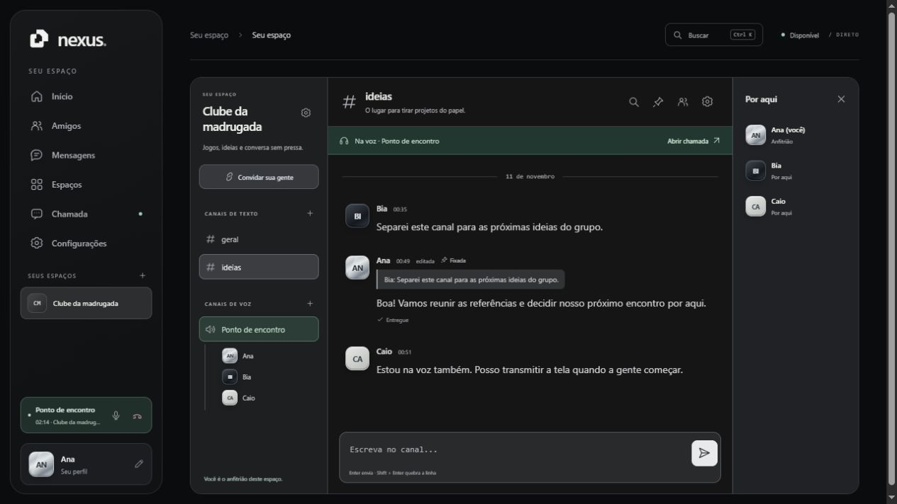

# Nexus

Amigos, conversas e espaços com canais de texto e voz, direto no navegador. Interface em preto, grafite e prata, com ícones vetoriais, perfis cromados e navegação responsiva. **Nexus continua sendo o nome provisório.**

## O que funciona

- ID de contato permanente neste navegador; solicitações de amizade, aceitar, recusar, cancelar, remover e bloquear.
- DMs com histórico local, fila de envio, confirmação de entrega e leitura, indicador de digitação, respostas, edição e remoção de mensagens próprias.
- Chamadas privadas entre amigos, com aceite explícito, recusa, cancelamento e encerramento sincronizado.
- Espaços por convite com nome, descrição, participantes e canais independentes de texto e voz.
- Configuração do espaço e criação, edição e exclusão de canais pelo anfitrião.
- Convites por link ou DM, com validade e renovação do link.
- Voz em grupo, microfone, silenciar áudio recebido e transmissão de tela dentro de cada canal ou chamada privada.
- Busca nas conversas, mensagens salvas localmente, mensagens fixadas pelo anfitrião, contagem de não lidas e busca rápida com `Ctrl + K`.
- Presença disponível/ausente/não perturbe; preferências sociais e exportação do histórico em JSON.
- Menu de canais no celular e controle da chamada enquanto se navega pelos chats.

## Como usar

1. Edite o perfil e copie seu **ID de contato** em Amigos. Envie o ID ou link de contato para a outra pessoa.
2. Com os dois navegadores abertos, envie e aceite a solicitação. Abra a DM pelo contato e use o telefone para iniciar uma chamada.
3. Em Espaços, crie um espaço e envie o convite. Entrar no espaço não ativa o microfone: cada pessoa escolhe um canal de voz quando quiser participar.
4. O anfitrião configura o nome e a descrição, cria canais e fixa mensagens. Cada canal de voz tem seu próprio grupo e transmissão.

Sirva a raiz em **localhost** para desenvolvimento ou publique em **HTTPS**. Não há etapa de build nem dependências de instalação. O cliente PeerJS é carregado pela CDN já utilizada no projeto.

## Como os dados e as conexões funcionam

Esta versão é uma aplicação estática com WebRTC e sinalização PeerJS. Não possui contas, banco central de mensagens ou servidor de voz permanente.

| Item | Comportamento nesta versão |
| --- | --- |
| Identidade | Chaves ECDSA P-256 no IndexedDB. O ID é derivado da chave pública. A conexão verifica uma prova assinada com um desafio novo. |
| Amigos, histórico e fila | Armazenados no navegador atual, em `localStorage`. Não sincronizam entre dispositivos. |
| DM para alguém offline | Fica na fila do remetente; é entregue quando os dois voltam a estar conectados. |
| Espaços | O navegador do anfitrião mantém a configuração, as associações e o histórico do grupo. Ele precisa permanecer aberto e conectado para entrada, publicação e voz do espaço. |
| Voz e tela | Conexões WebRTC entre os participantes do mesmo canal ou da chamada privada. O anfitrião coordena a lista de membros de cada canal. |
| Limites definidos no cliente | Até 128 membros por espaço, 64 canais e 16 participantes por canal de voz. Esses são limites de proteção do cliente, não uma garantia de capacidade de rede. |
| Rede | O sucesso de WebRTC depende das redes dos participantes e da infraestrutura de sinalização/ICE configurada no projeto. Não há TURN próprio nesta versão. |
| Captura e reprodução | Compartilhar tela e escolher saída de áudio dependem do navegador. Quando o navegador bloqueia a reprodução automática, a chamada oferece **Ativar áudio**. |

Limpar os dados do site remove a identidade local, os amigos e o histórico. A exportação JSON é uma cópia legível do histórico, não um backup restaurável da identidade. Use uma aba do app por navegador para evitar disputa pelo mesmo ID.

Para comunidades disponíveis o tempo todo, contas recuperáveis, histórico entre dispositivos e chamadas de grande porte, a próxima etapa é um backend com autenticação, persistência, TURN e uma infraestrutura de mídia apropriada.

## Estrutura

| Arquivo | Responsabilidade |
| --- | --- |
| `index.html`, `style.css`, `social.css` | Telas, sistema visual, diálogos e responsividade. |
| `identity.js` | Criação e persistência da identidade e verificação criptográfica. |
| `social-model.js` | Estado local, normalização, mensagens e fila persistente. |
| `social-client.js` | Autenticação das conexões, amigos, DMs, convites, espaços, canais e negociação de chamadas. |
| `community.js` | Renderização de amigos, conversas, canais e participantes. |
| `community-actions.js` | Formulários, busca, configurações, convites e integração da mídia. |
| `script.js`, `ui.js` | WebRTC, áudio, transmissão, navegação e preferências. |
| `avatars.js`, `assets/mark.svg` | Catálogo de perfis e símbolo vetorial. |

O conteúdo recebido de outros participantes é renderizado como texto. Chamadas recebidas exigem uma conexão autenticada e autorização para a sessão de voz atual. Alterações do espaço e dos canais são aceitas apenas do anfitrião.

## Perfis

Os monogramas Cromo, Carbono e Polar são provisórios. Para adicionar as artes fornecidas pelo usuário, salve-as em `assets/avatars/` e acrescente uma opção ao `AVATAR_CATALOG` em `avatars.js`:

```js
{ id: 'meu-icone', label: 'Meu ícone', src: 'assets/avatars/meu-icone.webp' }
```

Use IDs estáveis. A conexão transmite apenas o ID do catálogo e o nome do perfil. Perfis antigos com emojis migram para Cromo.

## Verificação

```sh
node --test tests/frontend.test.cjs tests/social-model.test.cjs tests/social-client.test.cjs
```

Os 36 testes cobrem identidade e desafios criptográficos, persistência, fila offline após reinício, amizade simultânea, autorização, DMs, leitura, edição, bloqueio, convites renovados, canais, histórico, isolamento da voz, consentimento de chamadas, limpeza de espaço encerrado e ciclo de mídia.

A validação no navegador usou três perfis de demonstração com conexões PeerJS/WebRTC reais e mídia sintética, sem acessar microfone ou tela pessoais. Foram conferidos amizade, DMs, convites, chat em grupo, respostas, edição, fixação, chamada privada, voz em grupo e recepção de transmissão. Captura de dispositivos físicos e compatibilidade entre navegadores distintos ainda precisam de validação em dispositivos reais.

## Prévia



[Ver a conversa no celular](docs/social-mobile.jpg)
